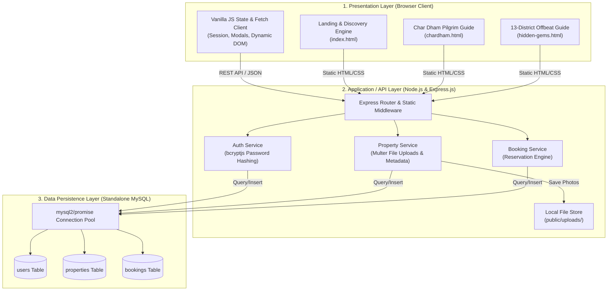
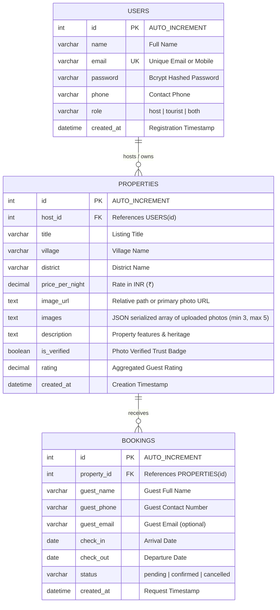
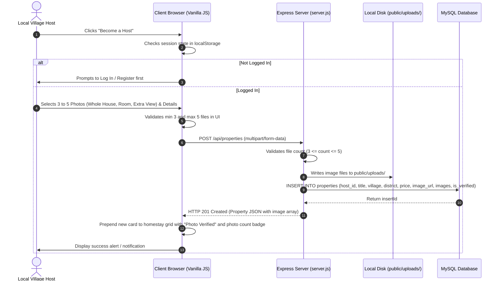
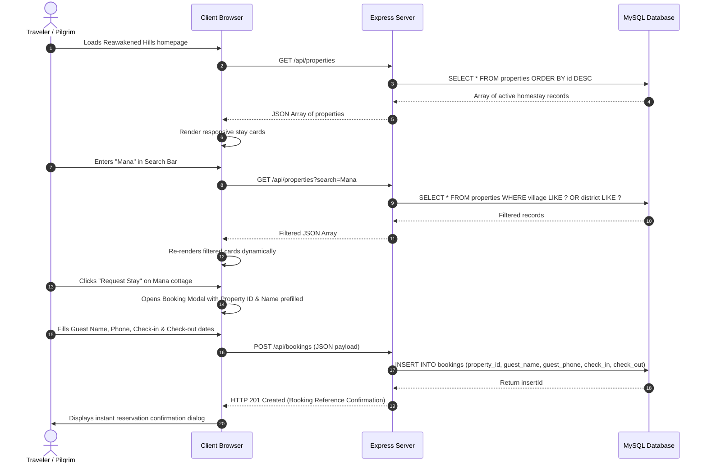

# Reawakened Hills — System Architecture Document

Comprehensive architectural specifications for **Reawakened Hills**, a rural homestay and tourism platform dedicated to revitalizing "ghost villages" in Uttarakhand.

---

## 1. Architectural Overview & Design Philosophy

Reawakened Hills is engineered around a **Decoupled 3-Tier Layered Architecture** with a lightweight, high-performance footprint:

### Core Design Principles
1. **Zero Bloat & High Speed**: Pure Vanilla JavaScript with the native `fetch()` API eliminates front-end framework overhead (no React/Angular/Vue build pipelines), ensuring instantaneous load times on low-bandwidth rural Himalayan mobile connections.
2. **Modern Marketplace Model (No Public Admin Bottleneck)**: Following Airbnb's host-empowerment paradigm, registered and authenticated hosts can instantly publish listings for their vacant ancestral homes. Listings immediately earn the "Photo Verified" trust badge upon validation.
3. **Resilient Data Access**: The database adapter uses `mysql2/promise` connection pooling with automatic keep-alive, parameterized queries (SQL injection prevention), and graceful startup handling.
4. **Clean Static Guide Integration**: Dedicated, high-speed static guides for the holy Char Dham circuit and all 13 districts' offbeat gems enrich SEO, educate travelers, and funnel bookings into rural village communities.

---

## 2. Layered Component Architecture

### 2.1 Presentation Layer (Frontend)
- **Framework & Styling**: HTML5, Modern CSS3 custom variables, Bootstrap 5.3 CDN, FontAwesome 6 CDN, and Google Font *Plus Jakarta Sans*.
- **Aesthetics**: Warm, earthy Himalayan color palette:
  - Deep Forest Green (`#1b4332`, `#2d6a4f`)
  - Warm Terracotta / Earth (`#8b5a2b`, `#d4a373`)
  - Clean Off-White Canvas (`#f8f9fa`, `#ffffff`)
- **Interactive Modals**:
  1. **Authentication Modal**: Tabbed registration and login interface with input sanitization and token persistence.
  2. **Become a Host Modal**: File input with image preview, property title, village, district, and nightly pricing.
  3. **Request Stay Modal**: Guest contact details, check-in/check-out dates, and instant confirmation feedback.
- **Client Scripting**: Modular Vanilla JS event handlers handling asynchronous `fetch()` requests, dynamic DOM card generation, and real-time search filtering.

### 2.2 Application / API Layer (Backend)
- **Runtime**: Node.js (v18+) with Express.js.
- **Middleware Pipeline**:
  - `cors()`: Cross-Origin Resource Sharing enablement.
  - `express.json()` & `express.urlencoded()`: Body parsing for JSON and form inputs.
  - `express.static('public')`: High-performance static asset streaming.
- **File Upload Engine (`multer`)**:
  - Disk storage configuration saving to `public/uploads/`.
  - Secure filename generator: `stay-[timestamp]-[random-hash].[ext]`.
  - MIME-type whitelist restricting uploads to `image/jpeg`, `image/png`, `image/webp`.
- **Security & Cryptography (`bcryptjs`)**:
  - One-way password hashing using standard 10 salt rounds.
  - Safe timing-attack resistant password verification via `bcryptjs.compare()`.

### 2.3 Data Layer (Persistence)
- **Database Engine**: Standalone MySQL 8.0 Community Server.
- **Driver**: `mysql2/promise` utilizing connection pools (`createPool`).
- **Connection Configuration**:
  - Pool size: 10 connections.
  - `waitForConnections: true`
  - `queueLimit: 0`
  - Parameterized prepared statements across all queries.

---

## 3. Entity-Relationship (ER) Architecture

---

## 4. Key Dynamic Interaction Flows

### 4.1 Host Listing Creation Flow

### 4.2 Tourist Discovery & Booking Flow

---

## 5. REST API Specification

### Authentication Endpoints
| Method | Endpoint | Description | Request Payload | Response |
| :--- | :--- | :--- | :--- | :--- |
| `POST` | `/api/auth/register` | Register new host or tourist | `{ name, email, password, phone, role }` | `201: { success, user: { id, name, email, role } }` |
| `POST` | `/api/auth/login` | Authenticate existing user | `{ email, password }` | `200: { success, user: { id, name, email, role } }` |
| `GET` | `/api/auth/me` | Verify active session | *Headers or query* | `200: { authenticated, user }` |

### Property Management Endpoints
| Method | Endpoint | Description | Request Payload | Response |
| :--- | :--- | :--- | :--- | :--- |
| `GET` | `/api/properties` | Fetch stays with search/filter | Query: `?search=Mana&district=Chamoli` | `200: [ { id, title, village, district, price_per_night, image_url, is_verified, ... } ]` |
| `GET` | `/api/properties/:id` | Fetch single property | None | `200: { id, title, village, district, ... }` |
| `POST` | `/api/properties` | Publish new homestay | `multipart/form-data`: `title, village, district, price_per_night, host_id, photo` | `201: { success, property: { ... } }` |

### Booking Endpoints
| Method | Endpoint | Description | Request Payload | Response |
| :--- | :--- | :--- | :--- | :--- |
| `POST` | `/api/bookings` | Submit stay reservation | `{ property_id, guest_name, guest_phone, guest_email, check_in, check_out }` | `201: { success, message, bookingId }` |
| `GET` | `/api/bookings` | Retrieve bookings list | Optional query | `200: [ { id, property_title, guest_name, ... } ]` |

### System Health
| Method | Endpoint | Description | Response |
| :--- | :--- | :--- | :--- |
| `GET` | `/api/health` | Service & DB status probe | `200: { status: 'healthy', database: 'connected', timestamp }` |

---

## 6. Security & Data Protection Controls
1. **Password Encryption**: All passwords stored in MySQL are hashed using `bcryptjs` with salt work-factor 10. Cleartext passwords never touch persistence logs.
2. **SQL Injection Mitigation**: All database queries executed via `mysql2/promise` strictly utilize parameterized statements (`?` placeholders).
3. **Upload Sanitization**: Uploaded files are strictly restricted to JPEG, PNG, and WebP. Randomly generated filenames prevent directory traversal and overwrite attacks.
4. **XSS Protection**: Dynamic DOM content insertion uses `textContent` and sanitized template literals to avert cross-site scripting vulnerabilities.
